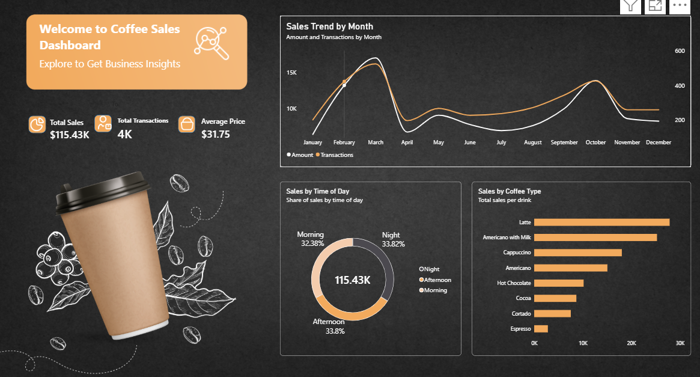

# ☕ Coffee Sales Dashboard (Power BI)

An interactive Power BI dashboard that analyses coffee shop sales across months, times of day and drink types, to show what sells, when it sells and where revenue is won or lost.



## Business Problem

A coffee shop owner wants to understand:

- How do sales and transaction volumes change month to month?
- Which drinks bring in the most revenue?
- At what time of day do customers buy the most?

This dashboard answers those questions in a single page so decisions on stock, staffing and promotions can be made quickly.

## Key Metrics

| Metric | Value |
|---|---|
| Total Sales | $115.43K |
| Total Transactions | 3,636 |
| Average Price per Transaction | $31.75 |

## Dashboard Visuals

- **KPI cards:** Total Sales, Total Transactions and Average Price.
- **Sales Trend by Month (line chart):** monthly sales amount and transaction count on a dual axis.
- **Sales by Time of Day (donut chart):** share of revenue from Morning, Afternoon and Night.
- **Sales by Coffee Type (bar chart):** revenue ranked by drink.

## Key Insights

1. **Latte is the top seller**, bringing in about a quarter of total sales. Latte, Americano with Milk and Cappuccino together make up roughly 60% of revenue.
2. **Espresso is the weakest product**, generating far less than every other drink. It is a candidate for a bundle or promotion.
3. **Sales peak twice a year**: a strong peak in March and a second, smaller peak in October, with a sharp drop in April between them.
4. **Revenue is spread almost evenly across the day**: Night (33.8%), Afternoon (33.8%) and Morning (32.4%). There is no single quiet period, so staffing and stock need to cover the whole day.
5. **Sales amount and transactions move together**, so growth comes mainly from more customers, not from higher prices.

> Figures are read from the dashboard. Update them if your data changes.

## Tools and Skills Used

- Power BI Desktop
- Power Query for data cleaning and preparation
- DAX measures for the KPIs
- Dashboard layout and design with a custom background and icons

## DAX Measures

```DAX
Total Sales = SUM(coffeedata[money])

Total Transactions = COUNTROWS(coffeedata)

Average Price = DIVIDE([Total Sales], [Total Transactions])
```

> Table and column names above are placeholders. Replace them with the ones in your model.

## Dataset

- **Source:** _add link here (for example Kaggle)_
- **Key fields:** date, coffee_name, money, Time_of_Day
- **Cleaning steps:** _add the steps you did in Power Query_

## How to Open

1. Download `coffeedata.pbix` from this repository.
2. Open it in Power BI Desktop (free, Windows only).
3. Use the report page to explore the visuals.

## Author

**Ajay Kumar Sabbani**
Data Analyst | Power BI | Sales & CRM Analytics
GitHub: [Ajaynetha1](https://github.com/Ajaynetha1)
